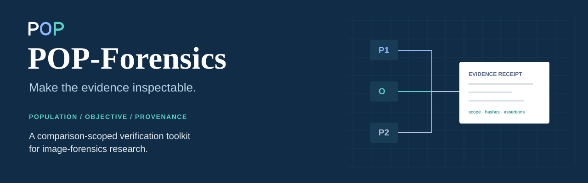
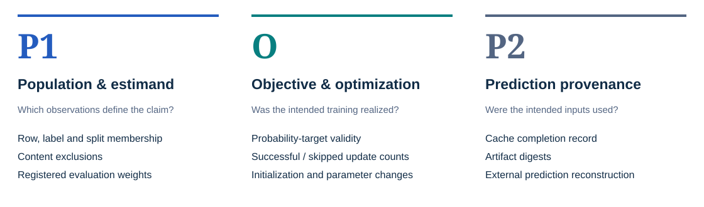
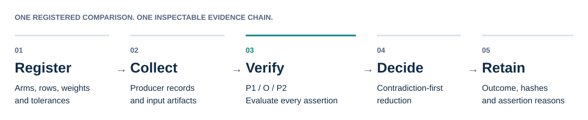
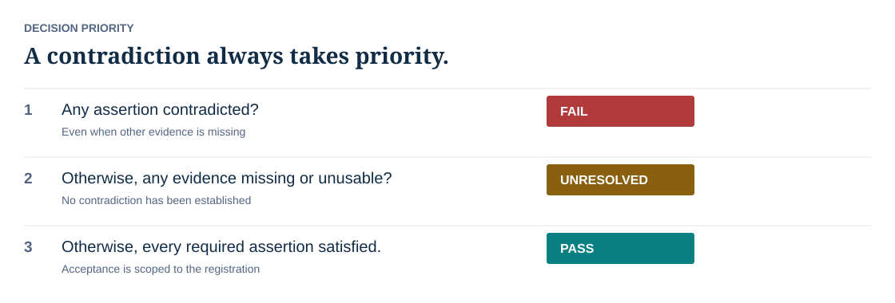
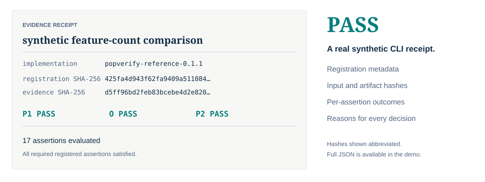
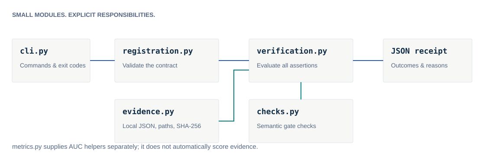

<p align="center">
  
</p>

<h1 align="center">POP-Forensics</h1>
<p align="center"><strong>Population, Objective, and Provenance Verification for Image-Forensics Research</strong></p>
<p align="center">Connect a model-improvement claim to the evidence behind it.</p>

<p align="center">
  <a href="https://github.com/mobashirsifat123/POP-Forensics/releases/tag/v0.1.1"></a>
  <a href="https://github.com/mobashirsifat123/POP-Forensics/actions/workflows/tests.yml"></a>
  <a href="https://github.com/mobashirsifat123/POP-Forensics/actions/workflows/tests.yml"></a>
  <a href="LICENSE"></a>
</p>
<p align="center">
  <a href="#installation">Install</a> · <a href="docs/quickstart.md">Documentation</a> · <a href="docs/examples.md">Examples</a> · <a href="docs/citation.md">Paper &amp; citation</a> · <a href="docs/contributing.md#build-this-documentation">Preview the website</a>
</p>

## Why POP?

Small AUC gains can change sign under different population weights. Invalid targets can suppress optimizer updates, and incomplete feature caches can alter selection and evaluation. A score difference alone cannot establish a reliable architectural improvement.

**POP binds explicit evidence requirements to one registered comparison.** This repository supplies a new, lightweight reference implementation of the protocol. It is verification software, not a detector or benchmark, and complements tools such as ForensicHub and experiment trackers.

## Follow the evidence





[Methodology](docs/methodology.md) · [P1 guide](docs/gates/population.md) · [O guide](docs/gates/optimization.md) · [P2 guide](docs/gates/provenance.md)

## Decisions with explicit priority



All assertions are evaluated. **FAIL takes priority over missing evidence.** PASS is scoped acceptance of supplied registered evidence; scientific judgment and trustworthy producer instrumentation remain necessary. [Decision rules →](docs/decision_rules.md)

## Installation

Python 3.10+ · CPU only · **No runtime dependencies**

```sh
git clone https://github.com/mobashirsifat123/POP-Forensics.git
cd POP-Forensics
python3 -m venv .venv
source .venv/bin/activate
python -m pip install .
```

The distribution is `pop-forensics`, the import is `popverify`, and the command is `popverify`. Install from this repository or [release assets](https://github.com/mobashirsifat123/POP-Forensics/releases/tag/v0.1.1); no PyPI publication is claimed.

## Your first verification

Run the committed synthetic example:

```sh
popverify validate examples/synthetic/package/registration.json
popverify verify examples/synthetic/package/registration.json \
  examples/synthetic/package/evidence.json
```

Selected lines from the **actual CLI transcript** (complete output in [the demonstration](docs/demonstration/pass.txt)):

<!-- demo:start -->
```text
PASS | synthetic feature-count comparison
  P1 membership: PASS — row membership and registered metadata
  O baseline-updates: PASS — realized optimizer updates
  P2 cache: PASS — artifact SHA-256
```
<!-- demo:end -->

Inspect the [registration](examples/synthetic/package/registration.json) and [evidence](examples/synthetic/package/evidence.json). To generate a fresh package, use `python examples/synthetic/generate.py output/demo` with a new destination. [Full quick start →](docs/quickstart.md)

### See why a decision changes

| Evidence condition | Actual outcome | Generated receipt |
|---|---|---|
| Complete synthetic package | **PASS** | [JSON](docs/demonstration/pass.json) |
| `baseline-delta` changed to zero | **FAIL** | [JSON](docs/demonstration/fail.json) |
| Cache-completion observation removed | **UNRESOLVED** | [JSON](docs/demonstration/unresolved.json) |

Regenerate all three with `python scripts/generate_demo.py`. This invokes the real CLI and checks exit codes. These are author-designed examples, not independent effectiveness measurements.

<details>
<summary><strong>Inside an evidence receipt</strong></summary>



Use `--json` for the complete receipt, or `--output receipt.json` to save it without overwriting an existing file. [Evidence contract →](docs/evidence_schema.md)

</details>

## A small, inspectable architecture

<details>
<summary><strong>View the module architecture</strong></summary>



</details>

```text
src/popverify/        registration · artifacts · checks · decisions · metrics · CLI
examples/            synthetic comparison and SICA/ForensicHub export guidance
docs/                searchable website, gate guides, schemas and research limits
tests/               unit, CLI, integration and 16-case conformance coverage
scripts/             reproducible demos, original diagrams and release audit
.github/workflows/   CPU tests and documentation build
```

[Architecture](docs/architecture.md) · [CLI reference](docs/cli.md) · [Python API](docs/api.md) · [Registration](docs/registration_schema.md) · [Integration guide](docs/integration.md)

## Quality and reproducibility

The existing suite covers 12 test methods, including 16 conformance cases: **1 PASS, 10 FAIL and 5 UNRESOLVED**. CPU CI passes on Python 3.10, 3.12 and 3.14. Cases are newly implemented author-designed fixtures, not independent sensitivity estimates.

```sh
python -m pip install -e '.[dev]'
python -m unittest discover -s tests -v
ruff check .
ruff format --check .
```

[Test report](docs/test_report.md) · [Reproducibility](docs/reproducibility.md) · [Release audit](docs/release_audit.md) · [Documentation build](docs/contributing.md#build-this-documentation)

## Research paper

*Beyond Headline AUC: Can Reported Improvements in Unified Image Forensics Be Verified? A Retrospective Study of Spatial and Patch Adaptations.* WI-IAT 2026; acceptance reported by the authors. Proceedings identifiers and a public paper URL have not been supplied.

Use [CITATION.cff](CITATION.cff) for software and manuscript metadata. [Citation guide →](docs/citation.md)

## Scientific scope

The **original historical validator, 58-scope validation matrix and 430-record archive catalog remain unavailable for independent inspection**. This new reference implementation does not reconstruct them or independently reproduce historical outcome counts. Synthetic conformance does not establish independent forensic effectiveness.

No raw images, historical predictions, restricted exports or pretrained weights are bundled. Researchers must produce trustworthy optimization records and externally reconstructed predictions. [All limitations →](docs/limitations.md)

## License and acknowledgments

New code, documentation and original visual assets are [MIT licensed](LICENSE). No upstream code, branding, prose or assets are copied. External dataset and model terms remain separate.

Design and engineering references: [ForensicHub](https://github.com/scu-zjz/ForensicHub), [IMDL-BenCo](https://github.com/scu-zjz/IMDLBenCo), [SICA/OpenMMSec](https://github.com/venus-guangjian/SICA_OpenMMSec) and the [existing SICA reproduction](https://github.com/mobashirsifat123/Strarting_case_for_ForensicHub_by_SICA). [Reference review](docs/reference_review.md) · [Source inventory](docs/inventory.md) · [Contribute](CONTRIBUTING.md)
