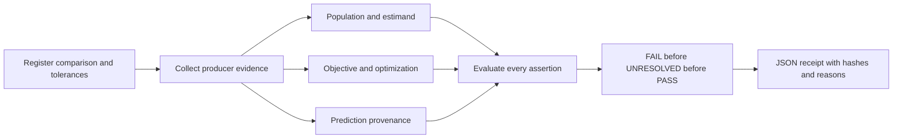

# POP-Forensics

**Population, Objective, and Provenance Verification for Image-Forensics Research**

POP helps researchers examine whether a reported model improvement is supported by the evaluation population, realized optimization and prediction inputs. It binds explicit assertions to one registered comparison and produces an inspectable **PASS**, **FAIL** or **UNRESOLVED** receipt.

Small AUC differences can change sign when manipulation types receive different weights. Invalid loss targets can suppress updates, and incomplete feature caches can alter both selection and evaluation. POP makes these evidence requirements explicit before interpreting a score difference.

This repository provides a **new reference implementation** of the documented protocol. It is research verification software, not a detection model or a benchmark. It complements experiment trackers and frameworks such as ForensicHub.

## Evidence producers adapted from the SICA audit

The repository now includes [working evidence-generation tools](docs/evidence_producers.md) adapted from the maintainer's original project on `pro6000`, with [source-file hashes and attribution](docs/source_adaptation.md):

- Native SICA manifest/CSV conversion with stable IDs and private-path removal from exported scores.
- Strict image byte/RGB census and exact-content-excluded cohorts.
- Fixed-cohort paired rescoring under all three AUC estimands.
- Live optimizer post-step tracking, target diagnostics and trainable-parameter deltas.
- Original DE3 JSONL training-log summaries with explicit missing coverage.
- Atomic cache publication, committed-byte inspection and mixed reconstruction diagnostics.

```sh
python -m pip install -e '.[images]'
python -m popverify.producers.cli --help
```

[Run the complete CPU image/training/reconstruction example](examples/evidence_pipeline/README.md) in an existing PyTorch environment. These producers are separately invoked; the original verifier CLI and decision rules are unchanged. They do not recover missing historical artifacts or automatically establish trustworthy coverage.

## Paper-specific analysis scripts

The [historical analysis scripts](docs/historical_analysis.md) include the original NumPy conformance experiment, saved-prediction rescoring and nine-run optimizer-log verification. The conformance experiment runs on synthetic data; the historical checks require the retained research exports, which are not published here. Install their optional dependencies with `python -m pip install -e '.[historical]'`.

## Evidence dimensions

| Gate | Questions | Implemented checks |
|---|---|---|
| **P1 — Population and estimand** | Which observations and weights define the claim? | Registered row/label/split metadata, disjoint content registries, estimand weights |
| **O — Objective and realized optimization** | Was the registered training actually realized? | Probability-target bounds/dtype, successful/skipped/nonfinite counters, initialization digests, parameter-change records, optional replicate lineage and attribution |
| **P2 — Prediction provenance** | Were predictions made from the intended inputs? | Completion record, cache SHA-256, externally reconstructed versus saved predictions |



## Install

Python 3.10 or newer; CPU only. No runtime dependencies.

```sh
git clone https://github.com/mobashirsifat123/POP-Forensics.git
cd POP-Forensics
python3 -m venv .venv
source .venv/bin/activate
python -m pip install .
```

The distribution is `pop-forensics`, the Python import is `popverify`, and the command is `popverify`. The package has not been published to PyPI; install from this repository.

## Quick start

From the repository root, with the environment activated:

```sh
python examples/synthetic/generate.py output/demo
popverify validate output/demo/registration.json
popverify verify output/demo/registration.json output/demo/evidence.json
popverify verify output/demo/registration.json output/demo/evidence.json --json
popverify verify output/demo/registration.json output/demo/evidence.json --output output/receipt.json
```

The generated comparison returns **PASS**. The generator refuses to overwrite an existing directory; choose a new output directory for each run. A ready-to-run package is also committed in [examples/synthetic/package](examples/synthetic/package):

```sh
popverify verify examples/synthetic/package/registration.json examples/synthetic/package/evidence.json
```

Inspect the registration to see the expected membership, weights, update budget and artifact digests. Inspect the receipt to see exactly which assertions were evaluated. [Quickstart](docs/quickstart.md) explains the Python API and failure cases. [Evidence schema](docs/evidence_schema.md) describes every check.

## Decisions

| Outcome | Meaning | CLI exit code |
|---|---|---|
| PASS | Every registered required assertion is satisfied | 0 |
| FAIL | At least one assertion is contradicted by evidence, even if other evidence is missing | 1 |
| UNRESOLVED | No contradiction, but at least one assertion lacks sufficient usable evidence | 2 |
| Invalid invocation or registration | No scientific decision is issued | 3; argparse syntax errors use 2 |

All assertions in version 1 are required. Missing or malformed evidence is never silently promoted to PASS. The checker evaluates all assertions so a missing file cannot hide a separate contradiction.

## Adapt to your experiment

1. Freeze arms, selection policy, row/label/split manifests, content exclusions, estimand and tolerances before fitting or inspecting results. Preserve the registration commit externally.
2. Instrument each arm: record actual post-scaler optimizer calls, skipped/nonfinite counts, target dtype/values, initial parameter digest and parameter changes.
3. Publish caches atomically, recording completion and digests. Independently rerun predictions from intended inputs using your framework.
4. Export evidence in the documented JSON schema and run `popverify verify`.
5. Share the registration, evidence, artifacts, receipt and limitations under suitable permissions.

See [the SICA/ForensicHub integration guide](examples/sica_forensichub/README.md). The native manifest/CSV adapters and producer utilities support evidence export; no detector trainer or automatic forensic inference adapter is bundled.

## Repository

```text
src/popverify/          registration, artifact access, checks, decisions, metrics, CLI
examples/synthetic/    deterministic CPU generator and ready-to-run package
examples/sica_forensichub/  external integration guide
configs/               registration guidance
tests/                 unit, CLI, integration and 16-case conformance coverage
docs/                  methodology, schema, provenance, limits and release reports
.github/workflows/     CPU CI across Python versions
```

## Tests

```sh
python -m pip install -e '.[dev]'
python -m unittest discover -s tests -v
ruff check .
ruff format --check .
python -m build
```

The new tests cover a clean case and 15 faults/gaps (1 PASS, 10 FAIL, 5 UNRESOLVED), decision priority, invalid registrations, malformed evidence, local path restrictions, artifact corruption, both-arm coverage, reconstruction tolerances, CLI behavior and AUC estimands. These are newly implemented fixtures inspired by the internal test taxonomy, not independently validated sensitivity estimates. See the [test report](docs/test_report.md).

## Research and reproducibility

The associated manuscript is *Beyond Headline AUC: Can Reported Improvements in Unified Image Forensics Be Verified? A Retrospective Study of Spatial and Patch Adaptations* (WI-IAT 2026; acceptance reported by the authors). Publication identifiers have not been supplied; no DOI or proceedings link is invented. [CITATION.cff](CITATION.cff) supplies software and manuscript metadata.

The **original historical validator, 58-scope validation matrix and 430-record archive catalog were not recovered for independent inspection**. This package does not reconstruct them or independently reproduce the historical outcome counts. It also does not redistribute raw images, historical predictions, private exports, pretrained weights or manuscript assets.

The prior internal NumPy test, historical rescoring receipts and this reference implementation have distinct roles. See [reproducibility](docs/reproducibility.md), [inventory](docs/inventory.md) and [limitations](docs/limitations.md). A PASS is scoped acceptance of supplied evidence, not a guarantee of scientific truth, model superiority or independent protocol effectiveness.

## Documentation

[Installation](docs/installation.md) · [Quickstart](docs/quickstart.md) · [Methodology](docs/methodology.md) · [Schema](docs/evidence_schema.md) · [Decisions](docs/decision_rules.md) · [Architecture](docs/architecture.md) · [Release audit](docs/release_audit.md)

## License and acknowledgments

New code and documentation in this repository are MIT licensed; see [LICENSE](LICENSE). No upstream implementation is vendored. Dataset, model and external project licenses remain separate.

Engineering references: [ForensicHub](https://github.com/scu-zjz/ForensicHub), [IMDL-BenCo](https://github.com/scu-zjz/IMDLBenCo), [SICA/OpenMMSec](https://github.com/venus-guangjian/SICA_OpenMMSec), and the [existing SICA reproduction repository](https://github.com/mobashirsifat123/Strarting_case_for_ForensicHub_by_SICA). Their modular organization, installation guides, configurations and citation practices informed this project; their code, branding, text and assets were not copied. See [reference review](docs/reference_review.md).

Contributions: open an issue with a minimal synthetic reproduction or a pull request with tests. Avoid uploading restricted datasets or private research exports. See [CONTRIBUTING.md](CONTRIBUTING.md).
