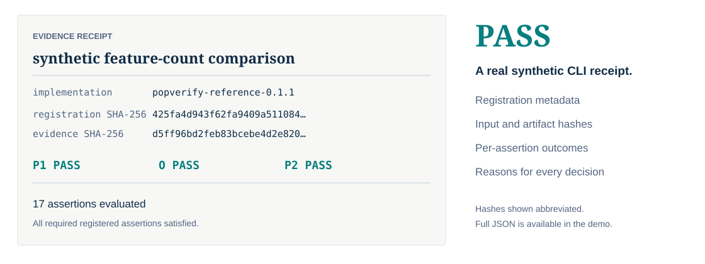

# A real CLI demonstration

These outputs are generated by the installed implementation. The clean package is copied from the committed synthetic example; the two altered conditions change only their evidence records. No historical experiment is rerun.

## Run the example

```sh
python examples/synthetic/generate.py output/demo
popverify verify output/demo/registration.json output/demo/evidence.json
```

Inspect the real [registration](https://github.com/mobashirsifat123/POP-Forensics/blob/main/examples/synthetic/package/registration.json) and [evidence](https://github.com/mobashirsifat123/POP-Forensics/blob/main/examples/synthetic/package/evidence.json). Each arm has its own optimization and reconstruction requirements. All three gates are required.

## Compare the outcomes

<div data-search-exclude markdown>

=== "PASS · complete evidence"

    The unchanged synthetic evidence satisfies all registered assertions. Exit code **0**.

    ```text
    --8<-- "docs/demonstration/pass.txt"
    ```

    [Full generated receipt](demonstration/pass.json)

=== "FAIL · stalled parameters"

    The `baseline-delta` observation is set to zero, contradicting its registered positive minimum. Exit code **1**.

    ```text
    --8<-- "docs/demonstration/fail.txt"
    ```

    [Full generated receipt](demonstration/fail.json)

=== "UNRESOLVED · missing completion"

    The `complete` observation is removed. No assertion is contradicted, but cache completion lacks evidence. Exit code **2**.

    ```text
    --8<-- "docs/demonstration/unresolved.txt"
    ```

    [Full generated receipt](demonstration/unresolved.json)

</div>

## Inspect the receipt

<div class="pop-figure" markdown>

</div>

The full JSON retains hashes, individual assertion decisions and reasons. The diagram abbreviates hashes for readability; the linked receipts contain actual values.

## Regenerate the demonstration

```sh
python scripts/generate_demo.py
```

This creates disposable copies under `output/documentation-demo/`, invokes the real CLI in each copy and writes transcripts plus JSON receipts under `docs/demonstration/`. Expected return codes are checked; a different outcome aborts generation. Run with POP installed in the Python environment.

Synthetic conformance demonstrates software behavior under these author-designed conditions. It does not establish independent forensic effectiveness. See [limitations](limitations.md).
